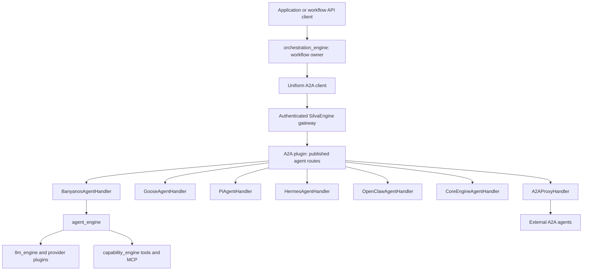

# BanyanOS Agent and Orchestration Integration Development Plan

Updated: 2026-10-26. Status: proposed implementation; documentation only.

This document owns the plugin handlers, protocol translation, identity propagation, and public task projection. The companion [orchestration development plan](../../../banyanos/orchestration_engine/docs/a2a_integration_development_plan.md) owns scheduling policy, engine changes, and cross-engine acceptance criteria. Both documents use the same architecture and delivery phases. Source observations refer to the review on 2026-10-26; runtime readiness has not been established.

## Decision

Add a dedicated `BanyanosAgentHandler` to `a2a_protocol_plugin`, following the extension pattern used by `CoreEngineAgentHandler`. Keep the existing CoreEngine bridge for its existing backend. The new Banyanos engine has different APIs, authentication, sessions, and task semantics, so it needs its own handler.

`orchestration_engine` runs workflows and acts as the A2A client. Applications control the workflow through its existing API. The engine owns agent selection, dependencies, scheduling, retries, approvals, aggregation, and cancellation propagation. The plugin exposes agent targets and translates their A2A calls into backend execution. `agent_engine` executes individual Banyanos agents; `llm_engine` remains behind it as the model/provider layer.

The required flow is orchestration -> A2A plugin -> selected agent handler -> backend. A workflow handler is unnecessary for this direction of integration. An authorized client can also invoke an individual agent endpoint directly.

The orchestrator invokes every coordinated agent through A2A routes published by this plugin: Banyanos, Goose, Pi, Hermes, OpenClaw, CoreEngine, and external A2A agents. Handler selection and backend-native transport belong to the plugin. Internal Banyanos agents follow the same A2A invocation contract as the other targets.



The parent workflow remains an orchestration execution. The plugin manages A2A agent tasks invoked by that execution and maps them to native backend runs. Validate agent registrations and proxy destinations to reject routing cycles or unintended calls back into the parent execution.

### Optional future workflow publication

`BanyanosOrchestrationEngineHandler` is an optional future adapter for exposing a complete workflow to external A2A clients. Implement it only if inbound A2A workflow invocation becomes a requirement. It is outside the required files, delivery phases and acceptance criteria below; orchestration of internal/external agents does not depend on it.

## Agent handler coverage

| Published agent type | Handler module / class | Backend-native transport | Status |
|---|---|---|---|
| Banyanos agent | `banyanos_agent_handler.BanyanosAgentHandler` | Authenticated GraphQL / WebSocket subscriptions through the gateway | Proposed handler |
| Goose | `goose_handler.GooseAgentHandler` | ACP over HTTP | Existing adapter; validate deployed capabilities |
| Pi | `pi_handler.PiAgentHandler` | Pi sidecar HTTP + SSE | Existing adapter; validate deployed capabilities |
| omp | `omp_handler.OmpAgentHandler` | omp sidecar HTTP + SSE (omp dialect of the pi sidecar) | Existing adapter; validate deployed capabilities |
| Hermes | `hermes_handler.HermesAgentHandler` | Hermes API HTTP + SSE | Existing adapter; validate deployed capabilities |
| OpenClaw | `openclaw_handler.OpenClawAgentHandler` | OpenClaw gateway HTTP + SSE | Existing adapter; remote cancellation is limited |
| CoreEngine | `core_engine_handler.CoreEngineAgentHandler` | GraphQL / WebSocket | Existing adapter; preserve existing registrations |
| External A2A agent | `a2a_proxy_handler.A2AProxyHandler` | A2A forwarding to the remote endpoint | Existing adapter; validate protocol-version compatibility |

Module names in this table are relative to `a2a_protocol_plugin.handlers`. These backends do not all need native A2A support: their handlers expose a common A2A surface and translate to each backend's API. Extend existing handlers only where required by the shared lifecycle contract; avoid building duplicate adapters.

Advertise capabilities per published target, based on verified handler/backend support. Do not assume equal streaming, approval, artifact, deduplication or recovery behavior across agents. The inspected OpenClaw handler's `cancel_run` unblocks its local stream while the backend may keep running. Distinguish that local interruption from acknowledged remote cancellation, and expose the limitation to orchestration policy.

## Scope and existing extension points

The existing handler loader in `handlers/a2a_ai_agent_utility.py` dynamically imports a configured module/class. Handlers receive `logger`, `agent_config`, `setting`, and `context`, and implement `ask_model`, `cancel_run`, and optionally `resolve_approval`.

Follow the GraphQL/WebSocket transport pattern in `core_engine_handler.py`: HTTP GraphQL for request/response calls and a gateway WebSocket for streaming subscriptions. Reuse its structural approach to authenticated transport and conversation mapping, while implementing the Banyanos schema. Its `ai_agent_core_graphql` operations and `ai_agent_core_ws` route belong to CoreEngine; Banyanos needs its own configured endpoints and operations.

Reuse `silvaengine_daemon` partitioning, serialization, repositories, SSE infrastructure, and async helpers. Preserve existing public dispatch names and legacy handlers. Do not import Banyanos database models into this plugin.

## Ownership

| Component | Owns |
|---|---|
| Gateway | Authentication and validated request identity |
| A2A plugin | Protocol validation, Agent Cards, public/child task state, messages/artifacts, SDK events, routing to registered backend handlers |
| orchestration_engine | Workflow execution, node selection, uniform A2A coordination of all agents, retries, approvals, aggregation, child cancellation |
| agent_engine | Agent configuration, task execution, sessions, conversation history, ReAct/tool loops and continuations |
| llm_engine | Provider selection, model calls, model usage and provider streaming |

The plugin projects each agent backend's lifecycle into an A2A task or response. The orchestration engine correlates those results with its workflow execution and nodes. A workflow can invoke many agent tasks without having a parent A2A task. The plugin does not start, schedule or resume the workflow itself.

## Proposed plugin files

All paths here are relative to the Python package directory `a2a_protocol_plugin/` unless stated otherwise. Names are proposed, not implemented.

| File | Responsibility |
|---|---|
| `handlers/banyanos_agent_handler.py` | `BanyanosAgentHandler`: invoke an agent, map conversations, observe results, stream and cancel |
| `handlers/banyanos_client.py` | Authenticated HTTP GraphQL and WebSocket subscription clients; variables, timeout/error handling and injectable test transports |
| `handlers/banyanos_identity.py` | Map trusted gateway context to permitted Banyanos tenant/actor and credential references |
| `handlers/banyanos_execution_map.py` | Durable public task/backend task/execution correlation through repositories |
| `handlers/a2a_ai_agent_utility.py` | Add optional type shorthands and lifecycle-aware output support; retain explicit module/class loading |
| `handlers/a2a_executor.py` | Emit backend-aligned nonterminal, waiting, terminal and artifact events |
| `handlers/config.py` | Validate optional bridge defaults and approved service/credential references |

Tests: `tests/test_banyan_agent_handler.py`, `tests/test_banyan_engine_client.py`, `tests/test_banyan_identity.py`, and an explicitly gated live integration suite. Add registration helpers similar to existing `register_*_agent.py` scripts.

## Handler registration and configuration

Example non-secret agent metadata:

```json
{
  "module_name": "a2a_protocol_plugin.handlers.banyanos_agent_handler",
  "class_name": "BanyanosAgentHandler",
  "banyanos_service_ref": "banyanos-staging",
  "banyanos_agent_id": "<published-agent-id>",
  "banyanos_credential_ref": "<approved-secret-reference>"
}
```

These are proposed agent settings. Resolve service URLs and credentials through trusted deployment configuration; do not accept arbitrary target URLs or credential references from public message metadata. Record the published backend version with each invocation so later configuration changes cannot silently change an ongoing execution.

The configured backend agent ID is authoritative. Public client input must not override it to invoke an unrelated or unpublished agent. Add a `banyanos_agent` shorthand only after explicit module/class registration works. No orchestration-handler registration is required for the scope of this plan.

Register each Goose, Pi, Hermes, OpenClaw, CoreEngine and external A2A target using its existing handler configuration and a stable published agent reference. The orchestrator stores that reference and the authorized plugin route, not backend credentials or backend-native routing logic. Resolve a target-specific Agent Card or capability view consistent with the selected registration; a global card must not imply that every target supports every feature.

## Backend operation contracts

### GraphQL and WebSocket transport

`banyanos_agent_handler.BanyanosAgentHandler` connects to Banyanos through the gateway, using the same two transport modes as the CoreEngine handler:

| Mode | Handler-to-backend transport | Banyanos operation / route |
|---|---|---|
| Non-streaming invocation | HTTP GraphQL | `invokeAgent` at `POST /{endpoint_id}/agent_engine_graphql` |
| Streaming invocation | WebSocket GraphQL subscription | `agentInvokeStream` through the configured Banyanos gateway WebSocket route |
| Query existing task / request cancellation | HTTP GraphQL | Agent task queries / `cancelTask` at the GraphQL endpoint |
| Reconnect to ongoing execution | WebSocket observe-only subscription, with GraphQL reconciliation | Requires observation of an existing task without invoking it again |

Resolve GraphQL and WebSocket URLs from the trusted `banyanos_service_ref` configuration. Keep credentials in the referenced secret/delegation source. Confirm the WebSocket route, handshake, message framing and authentication contract against the deployed gateway; do not assume an `agent_engine_ws` route already exists because CoreEngine has its own route. The reviewed Banyanos source exposes `agentInvokeStream`, while the deployment gateway supplies the long-lived transport.

The public orchestrator-to-plugin connection remains A2A. The plugin translates backend WebSocket events into bridge queue chunks, lifecycle/artifact events and public A2A SSE. It must handle WebSocket closure, errors, timeouts and cleanup, and preserve task/session identity across reconnects. Closing an observation socket does not by itself prove backend cancellation.

| Function | Existing Banyanos entry point | Required adapter behavior |
|---|---|---|
| Invoke individual agent | `InvokeAgent` / GraphQL `invokeAgent` | Send agent ID, message, session/context variables and a stable logical idempotency key |
| Continue conversation | Agent session/message APIs | Keep one tenant/actor-scoped context-to-session mapping; load history once |
| Stream agent execution | Subscription `agentInvokeStream` | Translate started/chunk/tool/completed/error events; preserve final output and structured metadata |
| Cancel agent task | `cancelTask` | Persist cancellation and signal active execution/continuation checkpoints; state update alone is insufficient |
| Observe agent execution | Agent task query/event APIs | Reconcile nonterminal agent work and publish terminal output only when backend execution finishes |

Workflow operations (`ExecuteWorkflow`, `ResumeExecution`, workflow approvals and `CancelExecution`) stay in the orchestration API. Applications call them to control the parent execution. The engine then invokes, observes, responds to or cancels individual agent tasks through A2A. Plugin handlers call backend agent APIs; they do not call workflow-control APIs in this scope.

Confirm exact deployed GraphQL input/query fields by schema inspection during implementation. Use variables for JSON fields and normalize string-encoded JSON where the existing schema requires it. GraphQL HTTP 200 responses with `errors` are failures; a missing expected data field is also an error.

Treat backend HTTP authentication errors, GraphQL execution errors, task execution failures, and caller deadlines as separate error categories. Map them through the SDK's typed errors or task states as appropriate; preserve a safe diagnostic code and trace reference without exposing credentials or backend internals.

`InvokeAgentStream` currently delegates to `InvokeAgent`; it is not by itself the token subscription transport. Do not start both an invocation and an invocation-producing subscription for the same logical message. Introduce an observe-only event API where needed to attach to an already-created task.

## Identity and tenant isolation

The plugin uses `endpoint_id#part_id` partitions; Banyanos uses validated tenant/operator identity. Define a trusted deployment-controlled mapping between them and verify resource ownership for every operation. Never derive authority from A2A message metadata or an unvalidated client header.

Before adding handlers, fix both plugin context paths: `main.py` currently merges request metadata after setting the partition, and `A2AServerCallContextBuilder.update_state_from_body` can overwrite state from request/message metadata. Allowlist user metadata and apply validated identity last. Reject missing identity on protected routes.

Extend bridge context construction to preserve the validated caller for Banyanos handlers. Its fresh CoreEngine-style context does not establish a Banyanos actor. Use narrowly scoped service credentials or approved delegation, with explicit backend authorization; never impersonate an actor claimed by the request body.

Keep gateway authentication ownership. Verify deployed A2A/admin route policy because existing deploy metadata includes `is_auth_required=False`. Public card discovery, protected execution, and admin CRUD require separate access decisions.

## Durable correlation and history

Persist mappings scoped to partition, validated tenant/actor, and published target:

- Public A2A `contextId` -> Banyanos agent session.
- Plugin A2A task ID -> native backend agent task/run/session IDs.
- Orchestration execution/node/logical invocation -> plugin agent task/context IDs (owned by orchestration).
- Proxy agent task -> remote A2A task/context IDs.
- Logical incoming message -> backend idempotency record and resulting execution.

For coordinated execution, distinguish the parent orchestration execution, each plugin-issued agent task, and the handler's native backend task/run/session. The orchestrator observes each agent task through A2A; the handler correlates and controls native execution. An external A2A proxy target adds its remote task/context mapping. Preserve execution/node trace correlation without treating the parent workflow as an A2A task or sharing native session IDs across tenants and targets.

Trace IDs provide observability and must not replace execution or conversation IDs. A backend run ID returned to the executor is a correlation identifier, not an authorization capability.

Reserve each logical submission with an atomic uniqueness check before invoking the backend. Include the target and caller scope in that record. Concurrent retries must resolve to the same invocation. A generated JSON-RPC request ID alone does not establish idempotency. If the backend accepted a request but its response was lost, reconcile it before resubmitting.

Use `conversation_map.py` and the setting repository where their guarantees suffice. Confirm concurrency/conditional-write behavior before using them for task deduplication. If a new entity or field is needed, update both DynamoDB and PostgreSQL models/repositories; add PG migrations, RLS policies and cache invalidation as required by AGENTS.md.

Banyanos should own conversation history for these handlers. Avoid replaying plugin history into a backend that already loads the same session history. Check ownership of any supplied existing session.

## Task lifecycle and bridge changes

The existing `{content, metadata, error}` handler return contract is adequate for short synchronous calls but does not fully express ongoing backend work. Add a backward-compatible structured lifecycle result/event contract, consumed by the bridge and executor, for Banyanos tasks. Older handler results retain existing behavior.

### Proposed internal result and event contract

Define this contract once in the bridge and use it in the Banyanos agent handler and other adapters that adopt lifecycle support. These are internal fields, not additional public A2A wire fields:

| Field | Meaning |
|---|---|
| `backend_ref` | Backend kind, task/execution ID and published target/version |
| `state` / `wait_reason` | Explicit lifecycle state and any actionable waiting condition |
| `content` / `artifacts` | Final content or typed artifacts; partial output must be marked as partial |
| `usage` | Reported model/tool usage, with unavailable values left unknown |
| `error` | Typed category, safe code/message and retry classification |
| `event_id` / `sequence` | Stable deduplication and ordering fields scoped to the backend execution |

Persist the public/backend task mapping before acknowledging accepted work. The bridge must consume `state`; a result without an `error` is not automatically completed. Keep the existing `ask_model` signature for initial compatibility, and make lifecycle support an explicit handler capability. Choose and test the exact internal schema before extending all executor paths.

| Backend condition | A2A semantic state |
|---|---|
| Accepted and queued | SUBMITTED |
| Executing or continuation queued | WORKING |
| Waiting for human response | INPUT_REQUIRED |
| Waiting for additional authorization | AUTH_REQUIRED |
| Actual terminal success | COMPLETED |
| Backend failure/deadline failure | FAILED |
| Execution cancellation acknowledged | CANCELED |
| Policy refusal | REJECTED |

Serialize exact protocol fields/enums through the tested SDK version. These states apply to agent tasks. A workflow HUMAN node is paused and approved within orchestration; only an agent's own input request maps to INPUT_REQUIRED and receives its authorized response through A2A. Preserve the same agent task when responding to that request. A new request in the same conversation may create a new task; a terminal task itself must never restart.

A direct A2A Message response has no remote task lifecycle to observe. Decode it as a completed agent response without inventing a remote task ID. An agent that continues work asynchronously must expose a task that the orchestrator can observe. Workflow state remains queryable through the orchestration API.

Prerequisite backend fixes: `execute_agent` currently returns `SUCCESS` even when `continuation_queued=True`; orchestration remote calls can turn protocol errors or nonterminal task results into node success. These need engine-side corrections; a handler cannot reliably hide them. Workflow resume must dispatch checkpointed work rather than only update database state.

## Streaming, cancellation and artifacts

Translate backend text deltas to artifact updates and backend lifecycle transitions to SDK status events. Tool progress can be optional structured metadata/events; default reasoning disclosure off and apply authorized policy before enabling it. Preserve structured data and file artifacts rather than flattening everything to text.

Always finish handler queue/event cleanup on success, failure and cancellation. Use true A2A SSE on the public streaming route. The gateway-dispatch path currently collects events into one JSON response and separately broadcasts gateway SSE; it requires incremental forwarding or an explicitly distinct transport profile.

Persist cancellation intent and task ownership. The plugin's process-local run registry alone cannot cancel after restart or across workers. Coordinate cancellation with backend checkpoints and use conditional transitions to resolve completion/cancellation races. Record requested cancellation separately from acknowledged cancellation. Stream disconnection stops observation by default; explicit cancellation controls durable work. Any different endpoint policy must be declared and tested.

Use a WebSocket observe-only subscription to project existing Banyanos task updates after the initiating request returns. If that backend capability needs to be added, identify it as a prerequisite; use bounded GraphQL polling for reconciliation until it is available. Observation and polling must not start execution again. Persist backend event cursors and publish committed updates through an outbox where required. Repeated events must not duplicate artifacts or regress terminal state. A gateway SSE broadcast by itself does not establish durable replay.

## Outbound A2A coordination

`orchestration_engine` owns agent selection and execution policy. Its proposed `utils/agent_invoker.py` invokes every published target through the plugin's A2A interface, and `utils/a2a_client.py` supplies SDK-backed protocol mechanics. Plugin handlers translate A2A into GraphQL, ACP, HTTP/SSE, WebSocket or remote A2A as required. Keep the outbound engine client independent of the plugin's server-handler package.

Use this route for sequential, decision, coordinator and parallel agent calls. Discover and validate the plugin's target-specific Agent Cards/capability views, select a compatible interface, resolve approved credentials, decode typed errors, persist plugin task IDs, and wait for terminal results before releasing downstream nodes. External A2A discovery and credentials are handled by the proxy adapter. Lock a tested SDK release and make legacy support explicit.

Remove orchestration's target-design bypasses to internal agent GraphQL and direct external A2A endpoints. GraphQL and WebSocket remain the Banyanos handler's backend transports; direct native routes are retained only for unmigrated workflows or explicit rollback. Agent-internal LLM and tool calls keep their existing interfaces. Prevent plugin handlers from choosing workflow branches or repeating workflow mutations independently.

Use execution/node/logical invocation in idempotency keys. Preserve that key across retries; separate distinct nodes invoking the same agent. After ambiguous timeouts, reconcile existing remote work before resubmitting side effects. Apply URL policy to discovery, advertised interfaces, redirects, artifact downloads and callbacks. Deduplication depends on both endpoints' contracts; do not promise exactly-once execution for arbitrary remote agents.

## Delivery phases and acceptance

| Phase | Lead owner | Deliverable and exit criteria |
|---|---|---|
| 1. Identity and protocol baseline | Plugin and gateway | Pin a tested SDK/protocol profile, fix metadata precedence, establish caller mapping and protected routes. Standard SDK requests work; spoofed metadata cannot change tenant/actor. |
| 2. Direct agent publication | Plugin and agent_engine | Add the agent handler and durable mappings. One independent SDK invocation returns the actual result; repeated logical requests are deduplicated. This is a deliberately limited synchronous slice. |
| 3. Task lifecycle and streaming | agent_engine and plugin | Repair continuation state; connect the Banyanos handler to WebSocket subscriptions and add observe-only task updates, incremental A2A SSE, cancellation and reconciliation. Ongoing work remains nonterminal across reconnect/restart; cancellation is observed by workers. |
| 4. Uniform agent coordination | orchestration_engine and plugin | Route every node through plugin-published A2A targets, checkpoint pending work and validate parallel routing. A Banyanos -> Goose -> Pi -> Hermes -> OpenClaw workflow and an external A2A branch preserve dependencies, artifacts and typed failures. |
| 5. Workflow approval and recovery | orchestration_engine and plugin | Implement authorized workflow approval/resume, result aggregation and child-cancellation policy. An orchestration execution spans internal/external agents and survives a human approval pause; agent tasks remain correlated through A2A. |
| 6. Operational readiness | All affected projects | Add compatibility checks, quotas, retention, metrics/traces and optional push delivery. Advertised capabilities match deployed behavior and the approved integration scenarios pass. |

## Rollout and decisions to close

Enable each new handler through deployment configuration and register one published target first. Retain existing CoreEngine registrations. Rollback stops new submissions while preserving observation/cancellation and mappings for accepted work. Review schema migrations for compatibility with existing plugin deployments and both storage backends.

During Phase 1, select and record the SDK release/protocol profile, public streaming route, service identity/delegation policy, task-observation source, worker/lease mechanism, retention and deadlines. The orchestration plan records coordination policy; this plan records the plugin configuration implementing it. Neither document assumes those choices are already implemented.

## Verification scope

Extend existing handler, executor, JSON-RPC bridge, protocol compliance and backend tests. Use injectable/mock transport to verify request fields, service credentials, GraphQL error handling, direct/wrapped results, nonterminal states, queue cleanup and cancellation. Add isolation tests for wrong-owner get/cancel/resume and metadata/header spoofing through both entry paths.

Add scripted WebSocket tests for the configured gateway handshake, subscription frames, event translation, disconnect/error cleanup, reconnect observation, and authenticated cancellation. Verify that one logical invocation uses either the non-streaming GraphQL path or the streaming invocation subscription and does not execute twice. Validate the deployed WebSocket route in the gated live suite.

Live scenarios must include session continuation, one actual LLM call, tool continuation, workflow with a remote agent, approval/resume, stream reconnect, process restart and ambiguous timeout. Confirm gateway authorization, installed SDK compatibility and both persistence backends. Update and approve the integration SOP before live test execution; this document does not certify runtime readiness.

Cover all registered handler types: Banyanos, Goose, Pi, Hermes, OpenClaw, CoreEngine and external A2A. Start the mixed-agent workflow through the orchestration API and verify Phase 4's chain and parallel branches through plugin routes, ensuring the orchestrator never calls backend-native endpoints in the migrated path. Check target-specific feature declarations, session isolation, execution/agent-task/native-run mapping, proxy-cycle rejection, and cancellation that is unsupported or only locally effective. No inbound A2A workflow endpoint is needed for these scenarios. Existing handler presence is not a passing integration result.

## Related documents

- [Plugin development plan](DEVELOPMENT_PLAN.md)
- [Goose integration plan](GOOSE_INTEGRATION_PLAN.md)
- [Pi integration plan](PI_INTEGRATION_PLAN.md)
- [Banyanos orchestration development plan](../../../banyanos/orchestration_engine/docs/a2a_integration_development_plan.md)

Cross-repository links assume the sibling `banyanos` and `silvaengine` checkout layout. Deployments may use different filesystem paths; runtime configuration must not depend on these documentation links.
