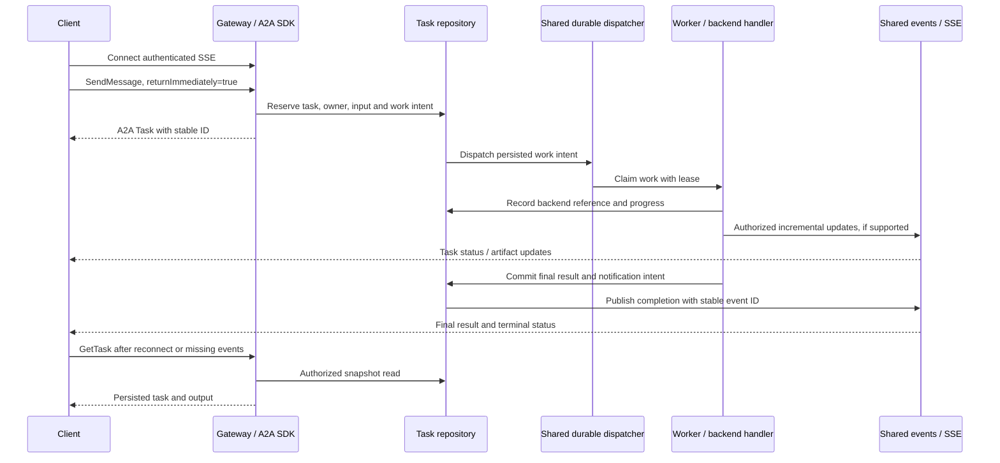

# Long-Running Tasks and SSE Delivery Development Plan

Updated: 2026-11-10. Status: proposed; this document does not implement the enhancement.

## 1. Outcome and compatibility decision

Support short and long-running agent tasks with durable execution, incremental
output when available, and reliable final-result delivery to the requesting user.
Support both streaming and non-streaming handlers. Keep existing clients working
while enabling the new lifecycle per deployment and published agent.

Task duration does not determine the public protocol contract. The client chooses
the response mode; execution uses the same durable lifecycle once the new mode is
enabled. A fast task can use asynchronous submission, and a slow task can still
have a blocking caller.

### Protocol correction to the initial discussion

A2A v1.0 section 3.2.2 requires blocking `SendMessage` calls, where
`configuration.returnImmediately` is false or absent, to wait for terminal or
interrupted state. When true, the operation returns after task creation. The flag
does not control streaming operations or direct `Message` replies.

Therefore, do not implement an automatic 15-second fallback that returns a
`WORKING` task to an ordinary blocking A2A request. The proposed 15-second budget
belongs to the application: it submits immediately, then chooses when to show a
progress screen while observing the accepted task.

### Behavior by client mode

| Client mode | Submission and observation | Compatibility requirement |
|---|---|---|
| Existing blocking client | Preserve its response contract; a task-based response waits for terminal/interrupted state. | No implicit asynchronous acknowledgment after a timer. |
| New asynchronous client | Send `returnImmediately: true`, receive a persisted task ID, then observe it. | Emit an initial SDK `Task` before expensive backend work. |
| Streaming A2A client | Receive SDK task, status, and artifact updates through a real streaming transport. | Do not label a collected JSON event list as native streaming. |
| Application using gateway SSE | Submit asynchronously and consume authorized task updates on its existing SSE connection. | Gateway event wrappers remain an application delivery contract. |
| Non-streaming backend | Publish lifecycle updates and a final result when available. | Do not invent token chunks or invoke a second time to obtain them. |
| Streaming backend | Publish incremental artifacts and a final result. | Preserve reasoning visibility, artifact identities, and output ordering. |

Keep existing route URLs and public dispatch names where possible. Implement
changes behind the routes. Actual streaming requires gateway response forwarding
changes; retaining an SSE URL does not imply that its implementation is complete.

## 2. Verified starting points

These observations describe source inspected on 2026-11-10, not live certification.

| Existing component | Observation | Required work |
|---|---|---|
| `main.py`, `A2ADaemonEngine.a2a()` | Calls SDK methods through `silvaengine_daemon.async_utils.run_async`. | Introduce task ownership that survives the request's temporary event loop. |
| `main.py`, `sse_message()` | Runs `self.a2a()` before publishing the response to the user. | Separate acceptance from execution and later notification. |
| `main.py`, `_collect_message_stream()` / `_collect_task_subscription()` | Drain events into a JSON POST response. | Retain documented legacy behavior; validate a distinct native streaming path. |
| `handlers/a2a_ai_agent_utility.py` | Non-streaming `ask_model()` runs synchronously inside an async function. | Run blocking handlers in managed workers. |
| Streaming bridge | Uses a 120-second drain timeout, sets a local event on expiry, then joins the thread. | Apply a common execution deadline and backend cancellation policy to new-mode work. |
| `handlers/a2a_executor.py`, `cancel()` | Accepts `task_id`; installed SDK 1.0.2 passes `RequestContext` and `EventQueue`. | Fix the SDK contract and verify it through the real request handler. |
| External-run registry | Process-local dictionary keyed only by task ID; normal completion does not unregister it. | Scope by tenant, clean up, and persist backend correlation for other workers. |
| `silvaengine_daemon.sse.SSEManager` | User delivery exists; client queues and replay history are in process memory. | Reuse it locally and add shared delivery for separate processes. |
| Bridge SSE helper | Broadcasts artifacts/status to an entire partition. | Deliver private task output to its authorized owner/subscribers. |
| Shared SSE replay | Filters by partition, without recipient identity. | Apply the same ownership rules to replay as live delivery. |
| Gateway SSE framing | Message ID is JSON data; data frames omit the SSE `id:` field. | Emit replay cursors in SSE framing and handle `Last-Event-ID`. |
| Banyanos submission | Reserves stable public task IDs and handles duplicate submissions. | Reuse concepts behind a common lifecycle, preserving existing reservations. |
| Banyanos continuation poller | Projects terminal state but does not publish completion SSE; its scan is PostgreSQL-only. | Integrate with the common finalization path and cover both repositories. |
| `config/a2a_config.example.json` | `task_timeout_seconds` has no identified runtime consumer. | Replace ambiguity with validated, documented runtime settings. |

The previous focused `test_phase10.py` attempt did not finish within a bounded
45-second run. Phase 1 must establish reproducible collection and execution before
claiming regression coverage.

## 3. Ownership and architecture

Follow [the ownership split](DEVELOPMENT_PLAN.md) and [repository guidance](../AGENTS.md).

| Component | Responsibility |
|---|---|
| Gateway | Authenticate callers, establish trusted identity, authorize SSE connections, frame/forward streaming responses, and set appropriate transport limits. |
| `silvaengine_daemon` | Reusable durable job dispatch, worker lifecycle, leases, cross-process event delivery, SSE replay primitives, and serialization. |
| A2A plugin | SDK contracts, tenant/actor authorization, public task state, backend correlation, handler execution policy, and A2A event projection. |
| Backend handler | Invoke once, report supported progress, expose a durable backend run reference when possible, and accurately report cancellation capability. |
| Frontend | Select response mode, correlate events by task ID, deduplicate updates, and recover task state after reconnect. |

Do not copy shared infrastructure into this plugin. The gateway's current
background handler and task backend are useful references, but an in-process
thread submission plus persisted status is not a restart-safe work queue.



### Durable task acceptance

Reserve the public task and execution intent before dispatch. Store a normalized
input reference, trusted partition/actor, published agent/configuration revision,
response mode, execution deadline, and submission identity. A successful
acknowledgment must mean the work intent is durable.

Use atomic repository operations for duplicate detection. Scope a new-mode
submission identity by partition, authenticated actor, published agent, and
message ID; reject reuse with different input or conversation. Distinguish a
retried submission from a subsequent user turn. Preserve existing Banyanos IDs
and ownership rules when adapting its ledger.

Use an atomic task-plus-work-intent write. Where a job transport cannot participate
in that transaction, persist a pending dispatch intent and let a reconciler submit
it idempotently. Cover crashes before and after external queue submission. Never
acknowledge volatile work or dispatch after reservation failure.

### Persistence contract

Phase 1 defines the shared job/event repository API before implementation. It must
provide conditional claim, lease renewal, fencing, conditional acknowledgment,
retry scheduling, and a recoverable notification outbox on both storage backends.

For plugin-owned data, prefer additive task fields `execution_metadata`
(DynamoDB Map / PostgreSQL JSONB) and `execution_version` (integer revision).
Keep final artifacts in the existing output/message representation. The metadata
contains durable owner, dispatch intent/work reference, backend reference,
deadline, cancellation outcome, and event publication references; it is not an
unbounded token log.

Implement conditional state changes in both task repositories. A stale worker,
completion callback, cancel request, or continuation poller cannot overwrite a
newer terminal decision. Keep generic leases and journal storage in the shared
daemon, rather than duplicating them in plugin models.

If these additive fields are used, update both models/repos, GraphQL exposure
where appropriate, cache invalidation, and a new Alembic revision. The next visible
revision is currently `0007`; recheck the head when implementation starts.
New shared/plugin tables require their own backend parity and tenant/RLS design.
Keep execution internals out of public task serialization; expose only authorized
artifacts and safe lifecycle diagnostics.

### Worker and credential lifetime

Use a worker lifecycle independent of request completion. Process deployments
may use daemon-owned services; serverless deployments require external durable
execution. Do not rely on a daemon thread surviving the end of a function call.
Refuse asynchronous acceptance if the configured execution service is unavailable
and no durable dispatch intent can be committed.

An SDK producer retained for a task must run on a daemon-owned event loop.
Do not retain a request coroutine on a loop closed by `asyncio.run()`, or access an
SDK `RequestContext`/`EventQueue` after its executor invocation has returned.
Worker events enter the durable event projection; request adapters attach to
that projection using the SDK-supported lifecycle.

Persist credential/delegation references only. Do not persist or enqueue the
forwarded bearer token, raw authorization headers, or the entire request context.
Resolve approved credentials at execution time; handle expiry as an explicit
failure or supported authentication interruption. Preserve the original actor's
authorization and audit identity.

### Execution and recovery

Use one logical invocation per accepted task. Shared workers claim with a lease
and renew while active. Persist backend run identity as soon as available.
On lease loss or restart, observe an existing backend execution before attempting
another invocation.

Exactly-once external side effects cannot be promised for every backend. If a
crash occurs after backend acceptance but before its reference is saved, reuse a
backend idempotency key where supported. Otherwise mark the dispatch ambiguous
and reconcile or require operator resolution; do not blindly invoke again.

Reuse one finalization operation for streaming, non-streaming, backend
continuations, execution failures, deadlines, and acknowledged cancellation.
Finalization commits output/status and a durable notification intent before
publication. Retry publication with the same event identity. Duplicate delivery
must be harmless.

Preserve `INPUT_REQUIRED` / `AUTH_REQUIRED` and existing approval methods.
An approval wait does not count as a completed task. Document whether the overall
execution budget continues during interruption; baseline policy uses a separate,
bounded approval/auth wait and never waits indefinitely.

## 4. Response modes, deadlines, and cancellation

Use protocol response mode independently from backend output mode. An
asynchronous task can stream artifacts or publish only a final result.
Preserve direct `Message` replies in the legacy immediate-response profile.
New asynchronous execution always starts with a trackable `Task`.

An application can choose asynchronous submission for all new-mode tasks and
display the result immediately when fast. After its local wait budget expires,
it shows progress. No duration prediction or second invocation is needed.

| Proposed setting / policy | Initial value | Meaning |
|---|---|---|
| `A2A_ASYNC_TASKS_ENABLED` | `false` | Rollout gate; preserve current behavior by default. |
| `A2A_ASYNC_AGENT_ALLOWLIST` | Empty | Only verified targets enter the new execution path. |
| `A2A_TASK_EXECUTION_TIMEOUT` | 600 seconds | Deadline across active backend execution; configurable within deployment limits. |
| `A2A_TASK_QUEUE_TIMEOUT` | 60 seconds | Maximum accepted queue wait before a persisted failure. |
| `A2A_TASK_CANCEL_GRACE` | 10 seconds | Bound backend cancellation attempts and cleanup. |
| Approval/auth interruption policy | Explicit bounded budget | Keep human waits separate from network idle and execution limits. |
| Shared event retention | Deployment configured | Retain replayable terminal events; fall back to task snapshots outside retention. |
| Application display wait | 15 seconds | Frontend behavior only; not an A2A response-mode override. |

All names and defaults in this table are proposals. Validate finite positive
durations and explicit precedence; client metadata must not increase trusted
limits or select an unauthorized target/owner. Existing `A2A_STREAM_TIMEOUT`
remains the legacy drain guard during rollout. New-mode execution must not fail
at that legacy 120-second limit simply because it continues to stream.
If explicit asynchronous submission is disabled or cannot be durably accepted,
return a documented SDK-typed error before backend dispatch; do not fall through
to a temporary-loop background task or silently treat the request as blocking.

Use monotonic elapsed time within a worker and persisted UTC deadlines for
recovery. Include handler setup and backend connection work in the defined
execution budget; keep queue wait, transport idle time, and execution deadline
distinct. Receiving tokens or heartbeats does not extend the total budget.

Fix `cancel(context, event_queue)` and pass its trusted call context to task-store
reads/writes. Authorize before touching backend execution. Route cancellation
through the worker that owns the run, including requests arriving on another
gateway worker. Honor the handler's return value instead of unconditionally
reporting success.

Record cancellation requested/confirmed/unsupported separately from public task
state. A deadline can finalize the public task as `FAILED` with a safe
`deadline_exceeded` diagnostic while recording that remote termination is
unconfirmed. A user cancellation uses `CANCELED` when accepted under the documented
backend capability; do not claim remote shutdown for OpenClaw's local-only stop.
Keep late callbacks from changing the final public decision.

Setting a local event, canceling a Python future, closing a socket, or expiring
an HTTP request alone is not evidence that backend work stopped. Use handler
stop APIs where available, bounded cleanup, and managed process isolation when
a hard execution boundary is required.

## 5. SSE, native A2A streaming, and final delivery

Use one canonical persisted task lifecycle, with adapters for SDK events and
gateway application events. Retain existing `task_status` / `task_artifact`
payload fields where compatible, and add task/context identity, artifact identity,
revision/sequence, stable event ID, and timestamp. Persist large output as an
authorized artifact reference instead of an oversized SSE frame.

Send private events using trusted recipient and partition membership. Persist
recipient scope in event records and apply it during replay. Never use frontend
task-ID filtering as authorization. Explicitly shared tasks require a server-side
subscription/permission check for each recipient.

For native A2A routes, use the SDK response/event serializers and actual streaming
HTTP responses. Preserve slash-style aliases through the compatibility adapter.
Document the legacy collected-event response separately and select its profile
explicitly; do not silently change its media type for existing clients. Resolve
the gateway's native-stream routing profile in Phase 1 before advertising its
capability or changing default behavior.

For browser SSE, emit `id: <cursor>` framing, UTF-8 data frames and bounded
heartbeats. Reconnect uses the cursor with tenant/user authorization. Choose a
gateway-approved authentication mechanism: native browser `EventSource` does not
provide an arbitrary Authorization-header option, so cookie-based access or an
existing authenticated fetch-stream client must be tested. Do not put durable
bearer credentials in URLs.

Fix replay registration/catch-up races with an ordered cursor boundary. Deduplicate
events across replay/live delivery and completion retries. Define snapshot recovery
for an expired/invalid cursor. Slow consumers must not block execution: bound queues,
close/recover lagging connections, and preserve task snapshots and terminal events.

Publish the final artifact before the completed status, after storage succeeds.
For a non-streaming handler this may be its first output artifact. For a streaming
handler identify the final artifact/snapshot so clients do not append the entire
answer a second time. Preserve files, structured data, reasoning controls,
`contextId`, and backend conversation mappings.

The connection may close or reconnect while execution continues. Streaming
delivery is retryable and may duplicate events. `tasks/get` remains the durable
recovery path. A standard A2A push webhook remains a separate, validator-protected
delivery mechanism and shares the finalization source.

## 6. Delivery phases and completion gates

### Phase 1 — Establish contracts and regression baseline

1. Make focused test collection reproducible without live services; identify the
   earlier startup/collection stall and record dependency versions.
2. Verify installed SDK behavior and declare a tested SDK range. Keep protocol
   v1 and legacy compatibility assertions separate.
3. Add a real SDK cancellation regression, then fix its executor signature and
   tenant context handling.
4. Define shared job/outbox APIs, additive persistence schema, credential provider,
   native-stream routing profile, and supported deployment topology.
5. Capture existing blocking/direct-message and collected-event behavior.

Gate: current clients have regression tests; cancellation crosses the real SDK
boundary; no unsupported automatic blocking-to-async fallback is in the contract.

### Phase 2 — Implement durable acceptance and workers

1. Implement shared dispatch/lease services and both storage backends.
2. Add transactional reservation, work intent, actor ownership and deduplication.
3. Introduce worker execution for synchronous and asynchronous handler methods.
4. Return a persisted initial SDK `Task` for explicit immediate-return requests.
5. Exercise dispatch through the real module-level entry point and close its
   request loop while the controlled backend remains active.

Gate: acceptance survives request teardown; duplicate submissions dispatch once;
failed persistence dispatches nothing; final output is queryable on both backends.

### Phase 3 — Enforce lifecycle limits and recovery

1. Add execution/queue deadlines, interruption budgets and bounded cancellation.
2. Persist backend references and implement cross-worker cancellation routing.
3. Add terminal revision checks, lease fencing and restart reconciliation.
4. Adapt Banyanos reservations and continuations without duplicating execution.
5. Remove active-run registrations on success, failure, cancellation and shutdown.

Gate: stalled work is bounded; late results cannot resurrect terminal tasks;
ambiguous backend acceptance is surfaced without blind resubmission.

### Phase 4 — Deliver authorized updates and completion

1. Publish SDK and application events from common task transitions.
2. Publish final result/status from the outbox, including continuation completion.
3. Fix recipient-aware replay, SSE framing, shared-worker delivery and backpressure.
4. Verify native streaming separately from legacy collection.
5. Validate disconnect/reconnect, browser authentication and task snapshot recovery.

Gate: a client connected to a different gateway process receives authorized output;
disconnects and publication retries do not lose the persisted final result.

### Phase 5 — Expand scripts and certify rollout

1. Complete the test changes and scenario matrix below.
2. Update API/checker scripts, versioned fixtures, examples and test documentation.
3. Run both-backend integration and gateway/daemon/worker end-to-end suites.
4. Enable selected agents, observe canary metrics, and record backend limitations.
5. Decide a later default-mode change using compatibility and operational evidence.

Gate: all required cases have evidence; live tests are explicitly gated; rollback
stops new acceptance while accepted tasks finish or enter documented recovery.

## 7. Test script enhancement work

### Existing plugin suites to extend

Paths below are relative to `a2a_protocol_plugin/tests/`.

| File | Required enhancement |
|---|---|
| `test_phase10.py` | Replace the timeout-only assertion with deadline, stop-attempt, result persistence, cleanup and event-order checks; cover async handler methods, reasoning and no duplicate final text. Keep mocked owner-validation tests, but add the real SDK path elsewhere. |
| `test_executor_unit.py` | Update cancel fixtures/calls to SDK context + queue; assert initial task, terminal updates, correct partition, ownership denial, rejected stop, and cleanup. Keep direct-message legacy regressions. |
| `test_a2a_jsonrpc_bridge.py` | Assert parsing of explicit true/false/absent `returnImmediately`, versioned names, task/status/artifact serialization and typed errors. |
| `test_a2a_protocol_compliance.py` | Exercise real SDK aggregation for new mode; assert blocking contract, immediate task acceptance, interrupted state and native streaming content type/order. Keep legacy alias coverage distinct. |
| `test_taskstore_output.py` / `test_task_context_projection.py` | Verify new-mode ownership/revision/output round trips, final artifacts, conversation IDs, files and safe diagnostics. |
| `test_banyanos_submission.py` | Extend concurrent dedup tests to new actor scope, content/context mismatch, persistence failure and recovery from reservation/dispatch gaps. |
| `test_banyanos_poller.py` | Verify common finalization and SSE after a committed terminal result; retries emit one logical completion; cancellation/timeout mapping and tenant cleanup work on both repositories. |
| `test_postgresql_backend.py` | Test migrations, conditional transitions, concurrent reservation, RLS separation and pooled-session reuse after every worker/event/recovery entry point. |
| `test_goose_executor.py` | Add task-mode invocation/get/cancel using actual SDK and task store; keep conversation/session resume tests. |
| `test_*_handler.py` | Add capability-specific stop, stalled transport and cleanup cases with existing scripted/mock transports; do not assert universal remote cancellation. |
| `test_a2a_proxy_handler.py` | Verify forwarding of response mode, correlation of remote task IDs, observe-without-resubmit, remote terminal failures and cancellation limits. |

### New focused suites

These are proposed files, not scripts created by this documentation change.

| Proposed file | Scope |
|---|---|
| `test_async_task_lifecycle.py` | Full acceptance/worker/get lifecycle with the real SDK and a controlled handler; blocking and immediate-return modes. |
| `test_task_deadlines.py` | Separate queue/execution/idle/interruption budgets, bounded stop and late-result races. |
| `test_task_submission_recovery.py` | Atomic reservation, queue gaps, lease loss, crash windows, backend ambiguity and outbox retry. |
| `test_task_sse_delivery.py` | Finalization-to-SSE behavior, recipient authorization, artifact order, replay gaps, duplicates and snapshot recovery. |
| `test_task_repository_concurrency.py` | Common repository contract run against DynamoDB and PostgreSQL; actual conditional writes and fencing rather than dictionary mocks alone. |
| `test_long_running_task_e2e.py` | Explicitly gated live gateway/daemon/worker scenarios, both output modes, reconnect and cross-worker delivery. |

Extend shared infrastructure tests in their owning repositories:

- `../silvaengine_daemon/silvaengine_daemon/tests/test_sse.py`: recipient replay,
  cross-loop delivery, cursor boundaries, duplicates, slow consumers and shutdown.
- Add daemon worker/outbox/lease contract suites with both persistence providers.
- `../silvaengine_gateway/silvaengine_gateway/tests/`: actual HTTP SSE framing and
  authenticated replay, native A2A streaming forwarding, client disconnects,
  heartbeat behavior, transport limits and distinct worker processes.

### API, compliance, and manual scripts

`test_api.py` currently uses a fixed 10-second HTTP timeout. Add separate CLI
controls for request timeout, overall observation deadline, and stream idle time.
Add explicit blocking, immediate-return, task-get, cancellation and SSE cases.
Proposed options are `--mode blocking|async|stream`, `--request-timeout`,
`--observation-timeout` and `--stream-idle-timeout`; document these only when
implemented.
Use gateway-issued test credentials and a task ID from submission; never obtain
it only from a final response. Bound all loops and close connections in `finally`.

Add a reusable authenticated SSE parser for test scripts. It must handle fragmented
UTF-8, multiple `data:` lines, `id`, `event`, heartbeat frames, EOF and reconnect.
Do not parse a stream by assuming one network chunk equals one event.

The existing `a2a_tck_checker.py` has a hard-coded implemented-operation list and
legacy method/card assumptions. Replace that list with requests and lifecycle
assertions against the selected protocol profile. Align `validate_agent_card.py`
with version-specific schemas/capabilities. Treat these as project compatibility
checks; do not claim official TCK certification from their filenames.

Extend `test_a2a_proxy_e2e.py` and the owning gateway's live SSE scripts to record
acceptance latency, time to first artifact, time to completion and backend call
count. Keep tests opt-in, remove new dependencies on hard-coded local paths/ports,
and emit machine-readable results with nonzero exit codes on failed assertions.
Never print credentials or full sensitive requests.

Update `tests/README.md`, `.env.example` and marker registration together. Use the
existing `A2A_RUN_LIVE_API_TESTS` gate for general live scenarios; preserve Goose
and pi's dedicated live gates. Missing services are a skip only when their live
gate is off; an explicitly enabled certification run fails on missing dependencies.

### Required scenario matrix

| ID | Scenario | Required evidence |
|---|---|---|
| T01 | Legacy fast blocking request | Existing response shape, IDs and conversation behavior remain stable. |
| T02 | Blocking task exceeds application display budget | No premature `WORKING` response; final/interrupted result follows the chosen contract. |
| T03 | Explicit immediate-return request | Initial task is returned before the controlled backend is released. |
| T04 | Fast task through new lifecycle | One invocation and durable completed output, with no timing-dependent response-shape change. |
| T05 | Slow non-streaming backend | Acceptance precedes completion; final artifact/status arrive and match `tasks/get`. |
| T06 | Slow streaming backend | Multiple ordered artifacts arrive before completion; final text is not duplicated. |
| T07 | Reasoning/files/structured output | Visibility rules and final artifact data survive streaming and snapshot recovery. |
| T08 | Request loop teardown | Closing the dispatch request loop does not cancel accepted work. |
| T09 | Client disconnect and late connection | Work continues; authorized observation recovers final state. |
| T10 | SSE reconnect/cursor boundary | No missing terminal event; replay/live duplicates are harmless. |
| T11 | Expired cursor or history | Client receives a defined recovery signal/snapshot and retrieves the final result. |
| T12 | Different tenant and different actor in one tenant | Neither live output, replay, get, cancel nor approvals reveal another owner's task. |
| T13 | Spoofed metadata | Partition, recipient, deadlines, backend target and credential references cannot be escalated. |
| T14 | Duplicate concurrent submission | One public reservation and one logical backend invocation; changed input is rejected. |
| T15 | Queue submission failure/crash | Durable intent is recoverable; storage rejection does not dispatch. |
| T16 | Crash around backend acceptance | Recover via idempotency/observation, or expose ambiguity without automatic duplicate work. |
| T17 | Completion commit then publisher crash | Retry uses the same event identity; final task remains readable. |
| T18 | Worker lease expires | Stale worker writes are fenced; a new worker reconciles the original backend execution. |
| T19 | User cancel before and during execution | Real SDK cancellation reaches authorized work and emits the documented outcome. |
| T20 | Unsupported/rejected remote stop | Safe diagnostic distinguishes local finalization from confirmed remote termination. |
| T21 | Deadline during continuous output | Heartbeats/tokens do not extend the total deadline; no late completion overwrite. |
| T22 | Race: cancel, timeout and completion | One public terminal decision and one logical completion publication. |
| T23 | Queue backlog / exhausted worker pool | Bounded admission/queue wait; health and unrelated requests stay responsive. |
| T24 | Approval/auth interruption | Proper SDK interruption, bounded waiting and authorized continuation without a new logical invocation. |
| T25 | Cross-process gateway/worker | Client on process A receives events from worker B and can cancel through process C. |
| T26 | Slow SSE consumer | Bounded memory; execution continues; snapshot recovery restores the result. |
| T27 | Banyanos queued continuation | Observe existing work and deliver its terminal result without resubmission. |
| T28 | Backend parity and session reuse | DynamoDB/PostgreSQL have equivalent transitions; PG context is removed after failures too. |
| T29 | Shutdown and rollout disable | New work stops accepting; accepted tasks drain/recover and registrations are released. |
| T30 | Native streaming versus collected compatibility | Real streaming route delivers frames incrementally; legacy profile retains its documented shape. |
| T31 | Browser authentication | Supported browser client connects/reconnects without exposing a bearer token in a URL. |
| T32 | Worker credential expiry | Credentials are resolved safely; auth failure/interruption is explicit and durable secrets stay absent. |

### Test implementation rules

Prefer controllable fake clocks, barriers and events over multi-second sleeps.
Use scripted handlers for fast completion, blocked completion, token output,
backend failure, permission wait, acknowledged stop and unsupported stop.
Keep at least one real HTTP streaming test: buffered ASGI clients can hide
incremental-delivery bugs.

For cancellation, use an actual `DefaultRequestHandler`, executor, request context,
event queue and task store. Mock the backend network surface, not the SDK method
whose signature/lifecycle is being verified. Assertion of a method's existence
does not establish working cancellation.

Run real persistence and separate-process tests for race/recovery claims.
Inject faults at reservation, dispatch, backend acknowledgment, terminal commit
and publication boundaries. Assert backend invocation counts and durable records
in addition to HTTP/SSE payloads. Bound test duration and terminate spawned workers
and connections in teardown.

Keep unit fixtures independent of real `.env` credentials, automatic table creation
and live agent endpoints. Register new markers in `tests/pytest.ini` and
`conftest.py` if needed. Record dependency versions and clear collection errors.
Report the known stale gateway-auth/JWT tests separately from this enhancement.

## 8. Proposed validation commands and evidence

These commands become executable after the proposed suites exist. They are not a
claim that those tests have been implemented or passed.

PowerShell, from this repository:

```powershell
$env:PYTHONPATH = '..\silvaengine_daemon;.'
python -m pytest a2a_protocol_plugin/tests/test_async_task_lifecycle.py a2a_protocol_plugin/tests/test_task_deadlines.py a2a_protocol_plugin/tests/test_task_submission_recovery.py a2a_protocol_plugin/tests/test_task_sse_delivery.py -q -o addopts="" -o log_cli=false
python -m pytest a2a_protocol_plugin/tests/test_phase10.py a2a_protocol_plugin/tests/test_executor_unit.py a2a_protocol_plugin/tests/test_a2a_jsonrpc_bridge.py a2a_protocol_plugin/tests/test_a2a_protocol_compliance.py -q -o addopts="" -o log_cli=false
```

Run the repository contract suite in separately configured DynamoDB and PostgreSQL
jobs. Use provisioned isolated test resources; apply migrations to the PostgreSQL
test database before its suite. Run daemon/gateway suites in their owning checkouts.
Use the existing backend-specific environment settings and explicitly enable live
tests only in the environment intended for that validation.

Each certification report must include protocol/SDK versions, deployment topology,
storage backend, agent/backend versions, enabled features, scenario results,
acceptance/completion timing, cancellation capability, resource cleanup and any
skipped gates. An unavailable dependency or collection stall is not a pass.

## 9. Rollout, acceptance, and rollback

Keep the feature disabled by default. Enable scripted agents first, then selected
verified backends. Require both streaming and non-streaming evidence for each
published capability. Leave backend-specific limitations visible.

Track acceptance latency, queue age/depth, active tasks, deadline failures,
cancellation outcomes, orphan/ambiguous runs, worker lease loss, outbox lag/retries,
SSE reconnects, dropped/lagging consumers and recovery success. Log tenant-safe
task/trace references without credentials or answer contents.

Release requires T01-T32 in their applicable layers, both storage backends,
actual SDK cancellation, incremental native-stream evidence, user-scoped replay,
and separate-process completion delivery. Purely in-memory execution is a local
development profile, not the durability acceptance target.

Rollback disables new-mode acceptance and preserves readers, workers, event
publication and reconciliation for already accepted tasks. Keep additive schema
fields until retained tasks and events expire. A later migration of default
behavior is a separately reviewed compatibility change.

## 10. Reference material

- Repository architecture: [development plan](DEVELOPMENT_PLAN.md).
- Existing durable correlation/continuation design:
  [Banyanos integration plan](BANYANOS_INTEGRATION_PLAN.md).
- A2A Protocol v1.0 specification, sections 3.1, 3.2.2, 3.5 and 4.2.
- Installed `a2a-sdk` 1.0.2, `AgentExecutor` contract and
  `DefaultRequestHandler` implementation; recheck versions during Phase 1.
- WHATWG HTML Living Standard, section 9.2: SSE framing, event IDs, reconnection
  and the browser `EventSource` interface.
